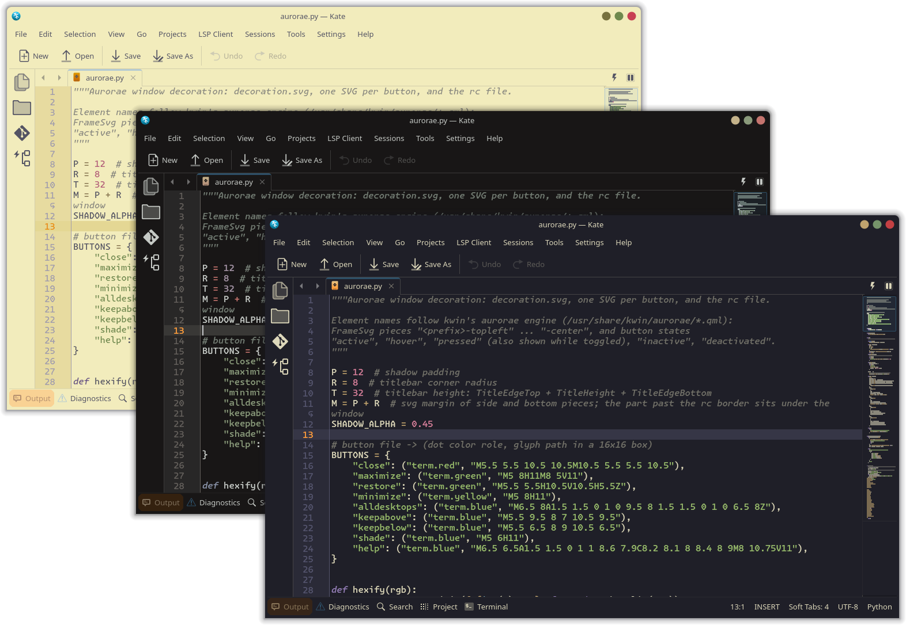
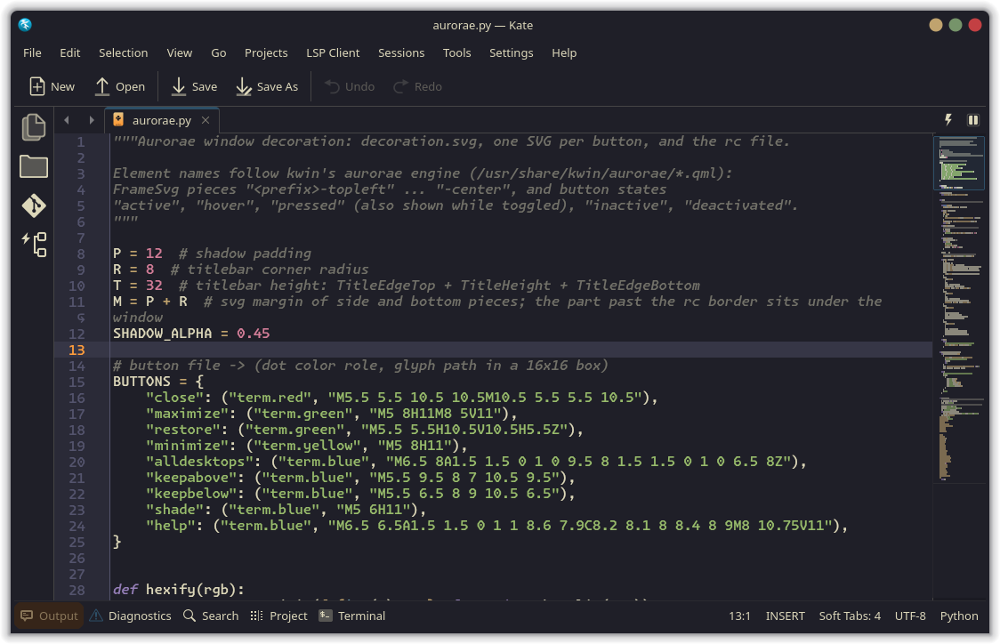
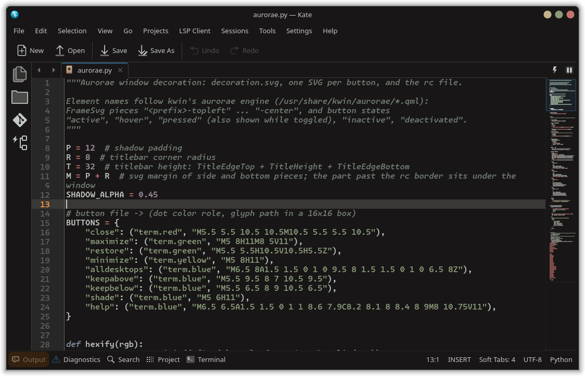
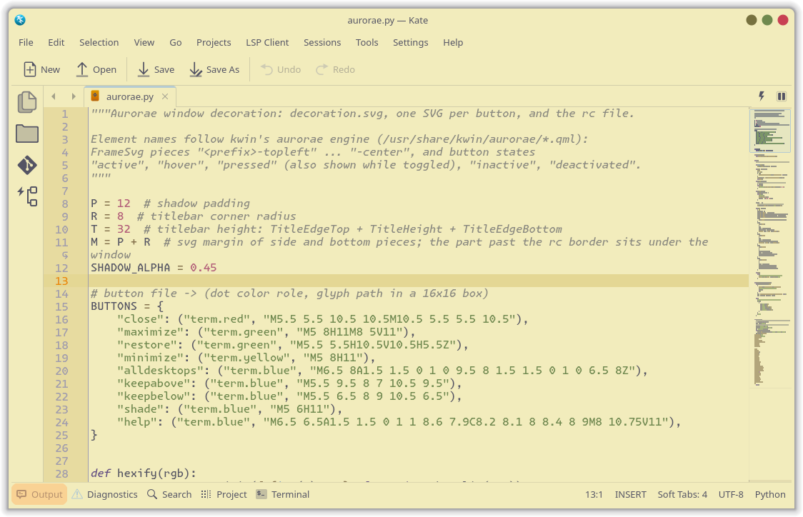

<h3>Kanagawa for <a href="https://kate-editor.org">Kate</a></h3>
<p>A community-maintained theme inspired by Hokusai's <em>The Great Wave off Kanagawa</em>.</p>
<p>Using the <a href="https://github.com/rebelot/kanagawa.nvim">Kanagawa palette</a> by <a href="https://github.com/rebelot">Tommaso Laurenzi (rebelot)</a>.</p>

<!-- Wave accents: carpYellow, crystalBlue, autumnRed. Lotus accents: lotusYellow, lotusBlue4, lotusRed. -->
<p>
  <a href="https://github.com/kanagawa-community/kate/stargazers">
    <picture>
      <source media="(prefers-color-scheme: dark)" srcset="https://img.shields.io/github/stars/kanagawa-community/kate?style=for-the-badge&amp;labelColor=1F1F28&amp;color=E6C384">
      <source media="(prefers-color-scheme: light)" srcset="https://img.shields.io/github/stars/kanagawa-community/kate?style=for-the-badge&amp;labelColor=F2ECBC&amp;color=77713F">
      
    </picture>
  </a>
  <a href="https://github.com/kanagawa-community/kate/releases/latest">
    <picture>
      <source media="(prefers-color-scheme: dark)" srcset="https://img.shields.io/github/v/release/kanagawa-community/kate?style=for-the-badge&amp;label=release&amp;labelColor=1F1F28&amp;color=7E9CD8">
      <source media="(prefers-color-scheme: light)" srcset="https://img.shields.io/github/v/release/kanagawa-community/kate?style=for-the-badge&amp;label=release&amp;labelColor=F2ECBC&amp;color=4D699B">
      
    </picture>
  </a>
  <a href="https://github.com/kanagawa-community/kate/issues">
    <picture>
      <source media="(prefers-color-scheme: dark)" srcset="https://img.shields.io/github/issues/kanagawa-community/kate?style=for-the-badge&amp;labelColor=1F1F28&amp;color=C34043">
      <source media="(prefers-color-scheme: light)" srcset="https://img.shields.io/github/issues/kanagawa-community/kate?style=for-the-badge&amp;labelColor=F2ECBC&amp;color=C84053">
      
    </picture>
  </a>
</p>

<br clear="both">
<br>

## Previews



<details>
<summary>🌊 Wave</summary>

</details>

<details>
<summary>🐉 Dragon</summary>

</details>

<details>
<summary>🪷 Lotus</summary>

</details>

## Requirements

- Kate, KWrite, KDevelop or another KDE application that uses KTextEditor, with
  KDE Frameworks 6.

## Installation

Download the themes into the syntax highlighting data folder:

```sh
mkdir -p ~/.local/share/org.kde.syntax-highlighting/themes
curl -fsSL -o ~/.local/share/org.kde.syntax-highlighting/themes/kanagawa-wave.theme https://raw.githubusercontent.com/kanagawa-community/kate/main/themes/kanagawa-wave.theme
curl -fsSL -o ~/.local/share/org.kde.syntax-highlighting/themes/kanagawa-dragon.theme https://raw.githubusercontent.com/kanagawa-community/kate/main/themes/kanagawa-dragon.theme
curl -fsSL -o ~/.local/share/org.kde.syntax-highlighting/themes/kanagawa-lotus.theme https://raw.githubusercontent.com/kanagawa-community/kate/main/themes/kanagawa-lotus.theme
```

Or clone the repository and run `./install.sh`. It installs all three variants,
or only the ones you name, for example `./install.sh dragon lotus`. `./uninstall.sh`
takes the same names and removes them.

## Usage

In Kate, open **Settings > Configure Kate > Color Themes**, pick
**Kanagawa Wave**, and click **Apply**. If the editor keeps its old colors,
turn off **Follow system color scheme** on the same page.

## Palette

Every color comes from the shared
[palette](https://github.com/kanagawa-community/.github/blob/main/docs/PALETTE.md),
picked by role, so each variant uses its own value for the same role. Comments
and keywords are italic and control flow is bold, as in the Neovim theme.

| Kate text style                    | Palette role     |
| ---------------------------------- | ---------------- |
| Normal                             | `ui.fg`          |
| Keyword                            | `syn.keyword`    |
| Control Flow                       | `syn.statement`  |
| Function                           | `syn.fun`        |
| Variable                           | `syn.identifier` |
| Operator                           | `syn.operator`   |
| Built-in, Annotation, Others       | `syn.special1`   |
| Data Type, Extension               | `syn.type`       |
| Preprocessor                       | `syn.preproc`    |
| Attribute, Import, Constant        | `syn.constant`   |
| String, Character, Verbatim String | `syn.string`     |
| Special String, Special Character  | `syn.regex`      |
| Decimal, Base-N, Float             | `syn.number`     |
| Comment, Documentation             | `syn.comment`    |
| Comment Variable                   | `syn.parameter`  |
| Region Marker                      | `ui.special`     |
| Information, Warning, Alert, Error | `diag.*`         |

| Editor color                              | Palette role               |
| ----------------------------------------- | -------------------------- |
| Background                                | `ui.bg`                    |
| Selection                                 | `ui.bg_visual`             |
| Current line                              | `ui.bg_p2`                 |
| Search and bracket matching               | `ui.bg_search`             |
| Replace highlight                         | `diff.text`                |
| Icon border                               | `ui.bg_gutter`             |
| Line numbers, separator, word wrap marker | `ui.nontext`               |
| Current line number                       | `diag.warning`             |
| Modified and saved lines                  | `vcs.changed`, `vcs.added` |

## Issues and contributions

Report bugs and request changes in this port's
[issue tracker](https://github.com/kanagawa-community/kate/issues). Contributions are welcome.

See [CONTRIBUTING.md](CONTRIBUTING.md) before opening a pull request.

## License

MIT. See [LICENSE](LICENSE).
